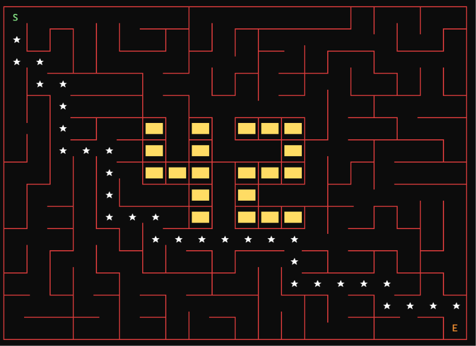
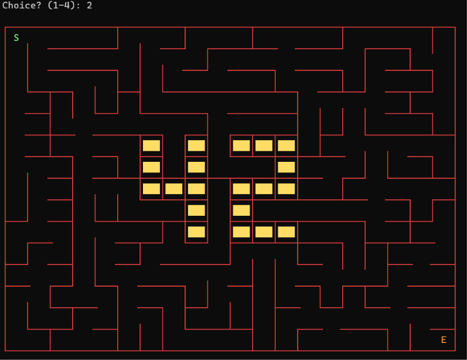
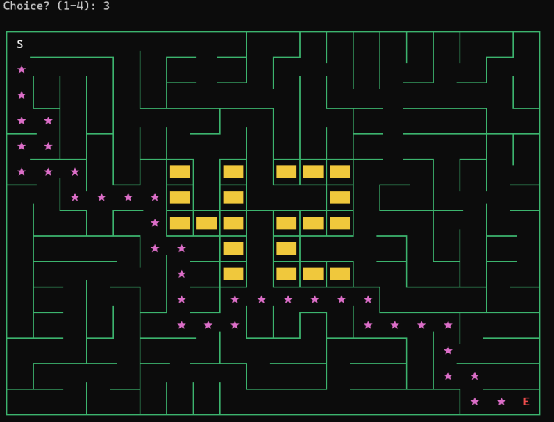

*This project was developed as part of the 42 curriculum by `ddervish` and `dshabani`.*

<div align="center">

# A-Maze-ing

**An interactive Python maze generator powered by randomized Prim's algorithm and Breadth-First Search.**

[](https://www.python.org/)


</div>

## Table of Contents

- [Overview](#overview)
- [Visual Showcase](#visual-showcase)
- [Core Features](#core-features)
- [Technical Architecture](#technical-architecture)
- [Maze Generation Algorithm](#maze-generation-algorithm)
- [Installation and Usage](#installation-and-usage)
- [Configuration](#configuration)
- [Output File Format](#output-file-format)
- [Reusable Python Package](#reusable-python-package)
- [Development and Quality Checks](#development-and-quality-checks)
- [Repository Structure](#repository-structure)
- [Team and Project Management](#team-and-project-management)
- [Tools and Technologies](#tools-and-technologies)
- [References](#references)
- [Use of AI](#use-of-ai)

## Overview

A-Maze-ing is a Python-based maze generation and exploration project developed as part of the 42 curriculum. It combines randomized maze generation, graph traversal and an interactive terminal interface in a single application. The program reads a configuration file, constructs either a perfect or non-perfect maze, calculates the shortest route between the entrance and exit using Breadth-First Search (BFS), and writes the result to the required output format.

The project separates the core maze-generation logic from the interactive interface. The reusable `mazegen` package handles the maze structure, generation, solving and serialization, while `a_maze_ing.py` and `display.py` provide configuration handling and terminal interaction. This separation makes the generation logic reusable independently of the visual interface.

## Visual Showcase

### 1. Maze Generation

<p align="center">
  
</p>

The first screenshot presents a generated maze in the interactive terminal renderer. It demonstrates the resulting grid structure, including the closed outer boundaries, the entrance and exit positions, and the protected 42 pattern at the centre when the grid dimensions allow it. The maze is generated through randomized Prim's algorithm, which progressively connects cells by removing selected walls while preserving the required structural constraints.

### 2. Shortest-Path Visualization

<p align="center">
  
</p>

This view demonstrates the shortest-path solving functionality. Breadth-First Search explores the maze from the entrance until it reaches the exit, determining a shortest route through the available passages. The resulting path is displayed directly in the terminal using a highlighted marker, making the relationship between the generated maze structure and graph traversal visible. The solution is also represented in the output file using directional instructions (`N`, `E`, `S`, and `W`).

### 3. Interactive Colour Themes

<p align="center">
  
</p>

The third screenshot highlights the terminal renderer's theme-switching functionality. Users can change the visual palette without needing to modify the maze-generation algorithm. The renderer uses ANSI colour sequences and box-drawing characters to distinguish maze elements, including the entrance, exit, shortest path and central logo. Multiple themes are available, allowing the same application to be displayed with different visual styles.

## Core Features

The project supports both perfect and non-perfect maze generation. A perfect maze is constructed as a spanning tree over all non-logo cells, meaning there is exactly one valid route between any two connected cells. In non-perfect mode, an additional randomized wall-removal pass introduces loops while preserving the subject's restriction against creating a completely open 3×3 cell block.

The generated maze maintains closed outer boundaries and consistent shared walls between neighbouring cells. All non-logo cells remain connected, and the shortest path between the configured entrance and exit is calculated using BFS. An optional integer seed makes generation reproducible, allowing the same configuration and seed to produce the same randomized result.

A distinctive feature is the protected 42 pattern placed in the centre of the maze. The pattern is represented by a 5×7 layout, with designated logo cells remaining fully closed and excluded from the maze's passages. If the grid is too small to accommodate the pattern together with its required surrounding border, the program continues without placing the logo and displays an informational message.

## Technical Architecture

The project is organized around a reusable maze-generation package and a separate application layer. The `mazegen/` package contains the grid representation, randomized generation, path solving and output serialization. The main entry point, `a_maze_ing.py`, coordinates configuration loading, generation and the interactive application flow, while `display.py` is responsible for rendering the maze and handling its visual presentation.

The package is designed to be imported independently, without requiring the terminal interface or main application script. This makes it possible to use the maze-generation and solving functionality in other Python projects.

The repository also includes a prebuilt Python wheel, `mazegen-1.0.0-py3-none-any.whl`, which can be installed into another environment and reused as a standalone package.

## Maze Generation Algorithm

### Randomized Prim's Algorithm

Perfect mazes are generated using an iterative implementation of randomized Prim's algorithm. The process begins by marking the entrance cell as part of the growing maze and adding its neighbouring walls to a frontier list. At each iteration, a random frontier wall is selected. If the cell on the opposite side has not yet been included in the maze and is not a protected logo cell, the wall is removed and the new cell is added to the growing structure. Its eligible neighbouring walls are then added to the frontier.

This process continues until the frontier is empty. The resulting structure is a spanning tree over the non-logo cells, producing a connected perfect maze with a unique route between any two reachable cells. The iterative implementation avoids recursive calls and therefore does not depend on increasing Python's recursion limit for larger mazes.

### Non-Perfect Maze Generation

When non-perfect generation is selected, the program performs an additional pass over the interior walls in randomized order. Each candidate wall is considered for removal according to the configured loop probability. Before accepting a removal, the program checks whether it would create a fully open 3×3 cell block. Any change that violates this condition is rejected, preserving the required maze constraint while allowing additional routes and loops.

### The 42 Pattern

The central logo is defined by `mazegen.LOGO_PATTERN` as a 5×7 pattern. Its designated cells are marked as protected before maze generation begins. These cells remain fully closed and are never added to the algorithm's frontier, ensuring that the maze passages do not carve through the logo.

## Installation and Usage

### Requirements

The project requires Python 3.10 or later and a POSIX-compatible terminal that supports 24-bit ANSI colour escape sequences.

### Installation

Clone the repository and install the project dependencies and reusable package with:

```bash
make install
```

This command creates the `maze_env/` virtual environment, upgrades `pip`, installs the development tools (`flake8`, `mypy` and `build`), and installs the prebuilt `mazegen` wheel from the repository root.

### Running the Application

The application can be launched using the default configuration:

```bash
make run
```

Alternatively, it can be started directly with Python:

```bash
python3 a_maze_ing.py config.txt
```

A different configuration file can also be supplied:

```bash
python3 a_maze_ing.py my_other_config.txt
```

The output file is generated on the first run and updated whenever the maze is regenerated through the interactive menu.

### Interactive Controls

The terminal menu provides four main actions. Option `1` generates another maze and updates the output file, while option `2` toggles the visibility of the shortest path. Option `3` switches between the available colour themes: emerald, ocean, amber, violet, rose, crimson, forest, neon, ice and gold. Option `4` exits the application.

The renderer uses `S` to represent the entrance, `E` for the exit, `★` for the shortest path and solid `███` blocks for the central 42 logo. These elements are visually distinguished through the selected terminal colour theme.

## Configuration

The application reads its generation parameters from a plain-text configuration file. The default `config.txt` is included at the repository root, and alternative configuration files can be supplied when launching the program.

| Key | Type | Required | Example |
|---|---|---|---|
| `WIDTH` | Positive integer | Yes | `WIDTH=20` |
| `HEIGHT` | Positive integer | Yes | `HEIGHT=15` |
| `ENTRY` | `x,y` coordinates | Yes | `ENTRY=0,0` |
| `EXIT` | `x,y` coordinates | Yes | `EXIT=19,14` |
| `OUTPUT_FILE` | String | Yes | `OUTPUT_FILE=output_maze.txt` |
| `PERFECT` | `True` or `False` | Yes | `PERFECT=True` |
| `SEED` | Integer | No | `SEED=42` |

Each configuration entry follows the `KEY=VALUE` format, with one pair per line. Lines beginning with `#` are treated as comments, and blank lines are ignored. Whitespace around the equals sign is permitted. The entrance and exit must refer to different cells within the grid, and neither position may overlap the protected 42 pattern.

The `SEED` parameter is optional. When it is omitted or left empty, the generator uses a random seed. Providing an integer seed makes the generation reproducible, which is useful for testing and debugging.

## Output File Format

The generated output file follows the format required by the project subject and is accepted by the accompanying `output_validator.py` script.

```text
<hex-row 0>
<hex-row 1>
...

<entry-x>,<entry-y>
<exit-x>,<exit-y>
<path string of N/E/S/W>
```

Each maze row is serialized as hexadecimal values, with one hexadecimal digit representing each cell. The four lowest bits encode the cell's north, east, south and west walls respectively: bit 0 represents north, bit 1 east, bit 2 south and bit 3 west. A set bit indicates that the corresponding wall is closed.

After the maze rows, the file contains the entrance coordinates, exit coordinates and shortest-path direction string. Every line, including the final line, ends with a newline character. This serialization keeps the generated grid and its calculated solution in the required subject-compatible format.

## Reusable Python Package

The maze-generation functionality is exposed through the standalone `mazegen` package. Its public interface provides access to the generator, grid and cell structures, shortest-path calculation and output serialization. Because it does not depend on `display.py` or `a_maze_ing.py`, the package can be reused in other applications without importing the interactive terminal interface.

For example, another Python project can create and solve a maze using the following interface:

```python
from mazegen import MazeGenerator, write_output

gen = MazeGenerator(
    width=20,
    height=15,
    entry=(0, 0),
    exit_pt=(19, 14),
    perfect=True,
    seed=42,
)

gen.generate()

# Access the generated grid
grid = gen.grid
cell = grid.cell(3, 5)

print(cell.walls, cell.is_logo)

# Retrieve the shortest solution
solution = gen.solution()
print(solution)

# Serialize the maze
write_output("maze.txt", grid, gen.entry, gen.exit, solution)
```

The prebuilt package is available at the repository root as `mazegen-1.0.0-py3-none-any.whl`. It can be installed into another Python virtual environment using `pip install mazegen-1.0.0-py3-none-any.whl`. To rebuild the wheel from the source under `mazegen/`, run `make build`.

## Development and Quality Checks

The repository includes a Makefile to simplify common development tasks. Run `make debug` to launch the application under Python's debugger (`pdb`). Run `make test` to execute the unit tests in `tests/` using Python's built-in `unittest` framework.

Code quality can be checked with `make lint`, which runs `flake8` and `mypy` using the required project flags. For more restrictive static checking, `make lint-strict` runs the tools with strict mypy settings. The command `make clean` removes generated development artefacts such as the virtual environment, build and distribution directories, Python cache folders and mypy cache. Finally, `make build` creates a fresh wheel from the package source.

## Repository Structure

```text
A-Maze-ing/
├── a_maze_ing.py
├── display.py
├── config.txt
├── Makefile
├── mazegen/
├── tests/
├── docs/
│   └── screenshots/
│       ├── 01-maze-overview.png
│       ├── 02-shortest-path.png
│       └── 03-maze-theme.png
├── mazegen-1.0.0-py3-none-any.whl
└── README.md
```

The repository keeps the application entry point, terminal display, reusable package, tests, configuration and documentation assets in separate locations. The screenshots used in this README are stored locally under `docs/screenshots/` and referenced through relative paths, so they are displayed directly from the repository without external image hosting.

## Team and Project Management

### Contributions

The project was developed collaboratively, with responsibilities divided between the reusable generation package and the interactive application. `ddervish` was responsible for the `mazegen/` package, including the grid, generator, solver and serializer, as well as wheel packaging and output-format compliance. `dshabani` worked on `a_maze_ing.py`, `display.py`, terminal themes, the interactive loop, configuration parsing, the README and the Makefile.

### Development Process

During the first week, the team reviewed the subject requirements, selected iterative randomized Prim's algorithm and agreed on the division of responsibilities. The wall encoding and cell/grid interfaces were designed together so that the display and generation components could be developed in parallel.

During the second week, the public interface of `mazegen.MazeGenerator` was established early. This allowed the terminal display to be developed against a defined package interface before the generation implementation was fully completed.

The third week focused on integration and validation. During this stage, the team identified that the restriction against fully open 3×3 areas needed to be checked locally after each attempted loop creation. The central 5×7 42 pattern was also integrated, and the spanning-tree connectivity of the remaining maze cells was verified.

### Lessons Learned

Defining the public interface of `MazeGenerator` early made integration between the two main parts of the project more straightforward. Producing the subject-compliant output directly from the `Grid` structure also made serialization independent of the internal state of the application. Choosing an iterative algorithm avoided recursion-limit issues and provided a straightforward approach to handling protected cells.

There are also areas that could be expanded in future versions. The current terminal display uses a single-window layout; a multi-pane terminal interface, potentially using `curses`, could make it possible to display additional maze statistics alongside the generated grid. The project could also be extended with alternative generation algorithms, such as Kruskal's algorithm or Wilson's algorithm, allowing users to compare different maze-generation approaches.

## Tools and Technologies

The project uses Python 3.12 as its primary development runtime, with Python 3.10 or later supported. `flake8` and `mypy` are used for linting and static type checking, while the `build` package is used to create the distributable wheel. Git provides version control, and Claude (Anthropic) was used as a sounding board for selected design discussions and README wording review.

## References

The implementation and development process drew on the following technical resources: [Randomized Prim's algorithm](https://en.wikipedia.org/wiki/Maze_generation_algorithm#Randomized_Prim's_algorithm), [Breadth-First Search](https://en.wikipedia.org/wiki/Breadth-first_search), [Spanning Trees](https://en.wikipedia.org/wiki/Spanning_tree), [PEP 257 — Docstring Conventions](https://peps.python.org/pep-0257/), the [flake8 documentation](https://flake8.pycqa.org/), the [mypy documentation](https://mypy.readthedocs.io/) and the [Python Packaging User Guide](https://packaging.python.org/en/latest/tutorials/packaging-projects/).

## Use of AI

AI assistance was used selectively during the project. It supported discussions about the trade-offs between Prim's algorithm and depth-first search, helped identify potential edge cases in configuration parsing and logo placement, and assisted with polishing the README's wording. The suggestions were reviewed against the project requirements and implementation, and relevant cases were checked manually.

No code was pasted into the project without being read and understood. Bug fixes were authored after the underlying problem and the reasoning behind the solution had been understood.
